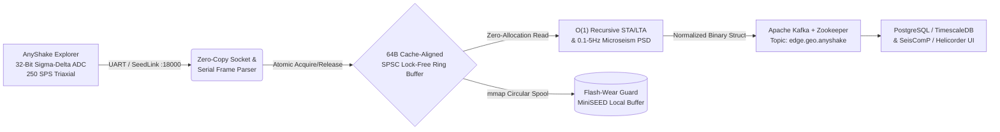

# ⚡ anyshake-spsc-bridge

### **Ultra-Low-Latency Rust/ARM64 SPSC Lock-Free Ingestion Daemon, $O(1)$ Recursive STA/LTA Trigger & Apache Kafka Bridge for AnyShake Explorer**

> **Deployment Status:** `Phase 1 Core Ring-Buffer & DSP Architecture Initialized` — *Awaiting SensePlex AnyShake Explorer Broadband Hardware Unit for Pier A-01 Commissioning (Coastal Bengal Basin Testbed: 21.880347°N, 87.589796°E | IIT Patna Research Node).*

`anyshake-spsc-bridge` is a high-throughput, zero-allocation systems daemon engineered in **Rust** to bridge physical **SensePlex AnyShake Explorer** 32-bit triaxial seismographs (`EHZ`, `EHN`, `EHE` / `ENZ`, `ENN`, `ENE` up to 250 SPS) into distributed **Apache Kafka**, **PostgreSQL/TimescaleDB**, and **SeisComP** pipelines without garbage-collection jitter or SD/NVMe flash wear.

Adapted from the `<30ns` [**Titan HFT Engine**](https://github.com/Nayan991111/Titan-HFT-Engine) and [**AlphaStream Intelligence**](https://github.com/Nayan991111/AlphaStream-Intelligence) architectures, this crate eliminates OS thread contention using a cache-line-aligned (`64-byte`) **Single-Producer Single-Consumer (SPSC) lock-free ring buffer** paired with an **$O(1)$ recursive Short-Term Average / Long-Term Average (STA/LTA)** P-wave arrival detector.

---

## 🏗️ System Architecture & Data Path

---

## ⚡ The Engineering Delta (Why Rust/ARM64 for Broadband Seismology)

Continuous 250 SPS 32-bit 6-channel seismic streaming on edge SBCs and workstations faces three structural bottlenecks in conventional runtimes:
1. **Runtime Garbage Collection Jitter:** Standard high-level forwarders experience periodic stop-the-world GC pauses during network reconnection bursts, causing UART/TCP receive buffer overruns.
2. **Flash Storage Write Amplification:** Flushing small MiniSEED records directly to SD cards or consumer NVMe drives degrades flash cells rapidly during continuous 24/7 operation.
3. **Sliding-Window CPU Overhead:** Naive $O(N)$ recalculation of STA/LTA trigger windows and Welch Power Spectral Density (PSD) across 6 channels consumes excessive CPU cycles on edge nodes.

### **Core Primitives Implemented in `anyshake-spsc-bridge`**
* **Cache-Line-Aligned SPSC Ring Buffer (`#[repr(align(64))]`):** Separates producer (`head`) and consumer (`tail`) atomic cursors onto distinct 64-byte ARM64 cache lines to eliminate false sharing (`L1D` cache invalidation) between the serial/SeedLink reader thread and the DSP/Kafka publisher thread.
* **$O(1)$ Recursive STA/LTA P-Wave Trigger:** Maintains running energy accumulators $E_{\text{STA}}$ and $E_{\text{LTA}}$ over circular fixed-size arrays, updating the trigger ratio $\eta(t) = \text{STA}(t) / \text{LTA}(t)$ in constant $O(1)$ time per 250 SPS sample without heap allocation.
* **Bay of Bengal Cyclonic Microseism Bandpass ($0.1\text{–}5.0\text{ Hz}$):** Extracts secondary oceanic microseism spectral power density generated by Northern Bay of Bengal cyclonic wave-wave interactions for downstream econometric and hazard modeling.

---

## 🗺️ 6-Week Execution & Hardware Validation Roadmap

- [x] **Phase 0 (Completed):** Lock-free SPSC ring buffer memory layout, 64-byte cache-line padding, and $O(1)$ recursive STA/LTA state machine specification.
- [ ] **Milestone 1 (Weeks 1–2):** Physical bolt-down commissioning of **AnyShake Explorer** on isolated interior RCC column **Pier A-01** (`21.880347°N, 87.589796°E`, Purba Medinipur, West Bengal), backed by G+3 solar PV + 24V Exide Solatubular UPS microgrid and $\pm 1\text{ms}$ GNSS/NTP stratum synchronization.
- [ ] **Milestone 2 (Weeks 3–4):** Full `AnyShake Observer` SeedLink (`TCP :18000`) & MQTT zero-copy binary framing into **Apache Kafka** (`edge.geo.anyshake`) and `mmap` circular flash-wear spooler.
- [ ] **Milestone 3 (Weeks 4–5):** Release of `anyshake-hil-bench` — a virtual PTY/SeedLink Hardware-in-the-Loop (HIL) stress-testing suite replaying historical USGS/IRIS teleseismic waveforms across 1,000+ simulated concurrent stations.
- [ ] **Milestone 4 (Week 6+):** Publication of South Asia broadband noise-floor PSD and Bay of Bengal cyclonic microseism benchmark pre-print (`arXiv cs.DC / q-fin.TR`).

---

## 🏛️ Institutional Affiliation & Attribution

Architected by **Nayan Pandit**  
* **Computer Science Student Researcher**, Indian Institute of Technology (IIT) 
* **Active Student Researcher**, IIT Madras Systems Engineering Society & IIM Mumbai Quantitative Finance Lab  
* **Hardware Target:** [SensePlex Limited — AnyShake Project](https://anyshake.org/) ("Listen to the whispering earth.")
