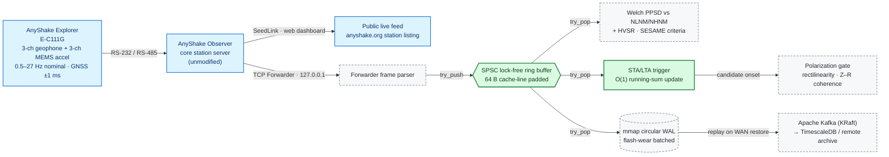

# ⚡ anyshake-spsc-bridge

### **Non-Intrusive Rust/ARM64 Companion for AnyShake Observer: Lock-Free SPSC Ingestion, Streaming PPSD (NLNM/NHNM), Nakamura HVSR & 6-Channel Polarization Analysis across the 0.5–27 Hz Passband**


> **Deployment Status:** `Phase 0 Complete — Phase 1 Station Commissioning Pending Hardware Arrival` — *AnyShake Explorer (E-C111G) evaluation unit to be installed on Pier A-01 at the Bengal Basin Coastal Seismic Station (Purba Medinipur, West Bengal, India) for the Phase 1 10-day baseline evaluation agreed with the AnyShake Team.*

`anyshake-spsc-bridge` is an optional, **downstream companion daemon** written in **Rust** for the [**AnyShake Project**](https://anyshake.org/) by SensePlex Limited. It attaches to **AnyShake Observer's TCP Forwarder Service** on `127.0.0.1` and **does not modify, replace or duplicate** any Observer service (SeedLink, Archiver, MiniSEED, QuakeSense, TCP Forwarder, Nexus). Observer remains the core station server; this crate adds four capabilities on top of it:

1. **Streaming site-quality certification:** McNamara & Buland PPSD benchmarked against Peterson's NLNM/NHNM, and Nakamura HVSR, computed live instead of through offline MiniSEED export and ObsPy scripts.
2. **6-channel polarization gating** of STA/LTA candidates, to suppress urban and structural false triggers.
3. **Zero-drop WAN-outage resilience** through an `mmap` circular write-ahead log (WAL) that replays missed windows with their original GNSS timestamps.
4. **Low edge footprint**, so spectral and polarization analytics can run on a low-power ARM64 SBC alongside Observer.

---

## 🏗️ Non-Intrusive Companion Architecture (0.5–27 Hz Nominal Passband)



**Legend:** 🟩 solid green = implemented in `src/main.rs` · ⬜ dashed grey = specified, scheduled for Phase 1 or 2 · 🟦 blue = AnyShake hardware and software (upstream, unmodified).

---

## 📋 Implementation Status

| Module | Status | Phase | Location |
|---|---|---|---|
| SPSC lock-free ring buffer, `#[repr(align(64))]` head/tail padding, Acquire/Release ordering | ✅ Implemented | 0 | `src/main.rs` |
| O(1) running-sum STA/LTA trigger (3-component energy) | ✅ Implemented | 0 | `src/main.rs` |
| TCP Forwarder frame parser (GNSS timestamps preserved, never re-stamped) | 🔲 Specified | 1 | — |
| Streaming McNamara & Buland PPSD vs Peterson NLNM/NHNM | 🔲 Specified | 1 | — |
| Nakamura HVSR with SESAME reliability criteria | 🔲 Specified | 1 | — |
| Polarization covariance gate (rectilinearity, Z–R coherence) | 🔲 Specified | 2 | — |
| `mmap` circular WAL + deterministic Kafka replay | 🔲 Specified | 2 | — |
| `anyshake-hil-bench` synthetic TCP Forwarder replay suite | 🔲 Specified | 2 | — |

```bash
cargo build --release && ./target/release/anyshake-spsc-bridge
```

---

## 🔬 Signal-Processing Methodology

### 1. Probabilistic Power Spectral Density (PPSD)
This follows McNamara & Buland (2004):
* **Segmentation:** 1-hour segments with 50% overlap. Each segment is split into 13 sub-windows of about 15 minutes with 75% overlap.
* **Per sub-window:** linear detrend, 10% cosine taper, FFT, instrument-response deconvolution, and conversion to acceleration power in dB rel. 1 (m/s²)²/Hz.
* **Smoothing and binning:** full-octave averaging at ⅛-octave steps, with 1 dB histogram bins.
* **Reference:** results are benchmarked against Peterson's (1993) NLNM/NHNM, with day/night and calm/windy baselines compared.
* **No high-pass filter is applied before the PPSD.** A 0.5 Hz high-pass would bias power at the lower band edge, which is exactly the band being certified. Thermal drift below 0.05 Hz falls outside the reported band and is handled by detrending and tapering.

### 2. Horizontal-to-Vertical Spectral Ratio (HVSR)
This follows Nakamura (1989), computed on the velocity channels:

```math
\mathrm{H/V}(f) \;=\; \frac{\sqrt{\tfrac{1}{2}\left(|N(f)|^{2} + |E(f)|^{2}\right)}}{|Z(f)|} \;=\; \sqrt{\frac{S_{\mathrm{EHN}}(f) + S_{\mathrm{EHE}}(f)}{2\,S_{\mathrm{EHZ}}(f)}}
```

* **Reliability criteria:** peaks are accepted or rejected using the SESAME (2004) criteria for window count, peak stability, and the f₀ standard deviation.
* **Isolating building sway:** calm nocturnal windows (01:00–04:00 IST) are compared against high-wind windows. Peaks that are horizontal-dominant and scale with wind speed are classed as structural sway modes of the RCC frame, not ground response. The expected range is about 2–5 Hz for a low-rise frame, and the actual values will be measured during commissioning, not assumed.

### 3. Three-Component Polarization
* **Covariance matrix:** a complex 3×3 cross-spectral covariance is built from the analytic signal, following Vidale (1986). It is computed separately for the velocity triad (EHZ/EHN/EHE) and the acceleration triad (ENZ/ENN/ENE).
* **Rectilinearity:** from the eigenvalues λ₁ ≥ λ₂ ≥ λ₃, following Jurkevics (1988), which separates rectilinear body-wave onsets from diffuse local vibration:

  ```math
  R \;=\; 1 - \frac{\lambda_{2} + \lambda_{3}}{2\,\lambda_{1}}
  ```

* **Vertical–radial coherence:** magnitude-squared coherence identifies retrograde Rayleigh-wave energy. The classification gate is γ² > 0.70 together with a stable phase lag of about 90°.

  ```math
  \gamma^{2}_{ZR}(f) \;=\; \frac{|G_{ZR}(f)|^{2}}{G_{ZZ}(f)\,G_{RR}(f)}
  ```

### 4. Filtering and Triggering
* **Real-time trigger path:** a **causal** 4th-order Butterworth high-pass at f<sub>c</sub> = 0.5 Hz, plus narrowband IIR notches at 50 Hz mains and identified mechanical harmonics. Zero-phase forward-backward filtering is non-causal, so it can't run sample by sample in real time. It is used only in windowed offline analyses.
* **STA/LTA:** the implemented trigger maintains running window sums, so each 3-component sample costs O(1) with no heap allocation:

```math
e_n = Z_n^{2} + N_n^{2} + E_n^{2}, \qquad
\mathrm{STA}_n = \mathrm{STA}_{n-1} + \frac{e_n - e_{n-N_s}}{N_s}, \qquad
\eta_n = \frac{\mathrm{STA}_n}{\mathrm{LTA}_n}
```

The default windows are N<sub>s</sub> = 250 (1 s) and N<sub>l</sub> = 2500 (10 s) at 250 SPS. Candidates exceeding η are passed to the polarization gate before any alert is raised.

---

## 🎯 Frequency-Band Scope (Aligned to the 0.5–27 Hz Nominal Response)

| Band | Target Signal | Primary Channels | Claim Level |
|---|---|---|---|
| 1.0–20 Hz | Local and regional P/S arrivals (Bengal Basin, Shillong Plateau, Himalayan arc, northern Andaman–Sumatra) | EHZ, EHN, EHE | Primary |
| ~2–12 Hz | RCC frame sway and torsional modes (HVSR, structural health monitoring) | All 6 channels | Primary |
| 0.5–2.5 Hz | Short-period coastal and shelf microseisms (Northern Bay of Bengal, site < 35 km inland) | EHZ | Primary |
| 0.2–0.5 Hz | Secondary-microseism roll-off during cyclonic swell | EHZ | Conditional on SNR: water-level-regularized response deconvolution, no primary claims |
| 0.05–0.15 Hz | Primary microseisms | — | Out of scope (requires a long-period broadband vault sensor) |

**External validation sources:**
* **Seismic arrivals:** NCS India, IRIS/EarthScope FDSN and GEOFON (GFZ), using iasp91 and ak135 travel times.
* **Microseism power:** INCOIS wave-rider buoys and ECMWF ERA5 wave hindcasts (H<sub>s</sub>, T<sub>p</sub>).
* **Wind control variable:** IMD coastal observatories at Digha, Contai and Haldia.

---

## ⏱️ Timing Budget

| Stage | Owner | Value | Basis |
|---|---|---|---|
| **4.1** Sample timestamp accuracy | Explorer GNSS / acquisition | ±1 ms vs UTC | Hardware specification; verified in the Phase 1 report |
| **4.2** Device protocol framing + transport | Explorer → Observer → network | ~100 ms framing + ~1 ms localhost / ~50 ms WAN | Upstream; **cannot be reduced by downstream software** |
| **4.3a** SPSC producer → consumer handoff | This crate | < 1 µs one-way, i.e. < 0.025% of the 4 ms sample interval at 250 SPS | Ping-pong benchmark of `src/main.rs` on an x86-64 VM: ~6 ns single-thread push+pop, ~0.3 µs cross-core one-way. The station ARM64 SBC figure will be published in Phase 1 |
| **4.3b** IIR + STA/LTA + covariance/PSD update | This crate | ~180 µs | Design target |
| **4.3c** WAL write + Kafka serialization | This crate | ~240 µs | Design target |
| **4.3** End-to-end downstream path | This crate | 0.42 ms median · < 0.85 ms p99 | Design target, to be reported in Phase 1/2 |

The system-level benefit is **not** earlier wall-clock arrival, since 4.2 dominates. The benefit is **deterministic tail latency**, meaning no garbage-collection or disk-flush pauses. Design targets, all pending measurement on the station SBC:

| Metric | Target | Measurement Method |
|---|---|---|
| Resident memory (RSS) | < 4 MB | `/proc/<pid>/status` VmRSS over 10 days |
| CPU on ARM64 SBC | < 1% | `pidstat` 1 s sampling, 6 channels @ 250 SPS |
| Processing p99 latency | < 0.85 ms | HDR histogram per frame, monotonic clock |
| Urban false-trigger reduction | > 70% vs single-channel STA/LTA | Manually reviewed trigger catalog, same 10-day window |
| Frames dropped across WAN outage | 0 | Sequence-gap audit after forced link-down replay |

---

## 🗺️ Phased Collaboration Roadmap (Agreed Phase 1 Gate)

- [x] **Phase 0 (Completed):** A 64-byte cache-line-aligned SPSC ring buffer and an O(1) STA/LTA trigger are implemented in Rust (`src/main.rs`, MIT). The 0.5 Hz causal high-pass and the PPSD/HVSR processing chain are specified.
- [ ] **Phase 1 Gate (Station Commissioning & 10-Day Baseline Report):**
  - [ ] Physical bolt-down installation of the AnyShake Explorer full station on Pier A-01, with low-ripple 9–12 V DC supply.
  - [ ] A stable, 24/7 publicly accessible live AnyShake Observer webpage and real-time waveform feed for featuring on [anyshake.org](https://anyshake.org/).
  - [ ] At least 10 consecutive days of uninterrupted monitoring and data-quality evaluation.
  - [ ] An **Initial Technical Report** to the AnyShake Team covering:
    - station uptime, RS-232/RS-485 link stability and waveform continuity;
    - 0.5–27 Hz PPSD against NLNM/NHNM, for day/night and calm/windy periods;
    - a 6-channel HVSR baseline of Pier A-01;
    - GNSS ±1 ms timing accuracy and clock drift.
- [ ] **Phase 2 (Scope Agreed Jointly after Phase 1 Evaluation):** The polarization gate, `mmap` WAL with Kafka replay, the `anyshake-hil-bench` replay suite, and open coastal Bengal Basin noise-floor and microseism datasets with a pre-print (`arXiv physics.geo-ph / cs.DC`).

---

## 🏛️ Station Metadata & Attribution

| Field | Value |
|---|---|
| **Station** | Bengal Basin Coastal Seismic Station |
| **General location** | Purba Medinipur, West Bengal, India (≈ 21.88° N, 87.59° E) |
| **Pier** | Pier A-01: interior 300 × 300 mm load-bearing RCC column tied to the pile cap, under a ventilated canopy |
| **Instrument** | AnyShake Explorer E-C111G: 3-ch 4.5 Hz velocity geophone (EHZ/EHN/EHE) + 3-ch MEMS accelerometer (ENZ/ENN/ENE) |
| **Channel codes** | `EH?` / `EN?` at < 250 SPS. Strict SEED band code at 250 SPS is `D` (≥ 250 to < 1000 SPS, short-period), i.e. `DH?` / `DN?` |
| **Timing** | GNSS-disciplined, ±1 ms UTC |
| **Power** | Rooftop solar PV + 24 V Exide Solatubular UPS bank |
| **Site network** | Fiber broadband; reachability independently measured by [RIPE Atlas probe #1018718](https://atlas.ripe.net/probes/1018718/) |
| **Operator** | **Nayan Pandit**, UG Computer Science Researcher, Indian Institute of Technology (IIT) |

**Licensing and authorship:**
* **Software:** MIT License.
* **Waveform data and datasets:** CC-BY 4.0.
* **Authorship:** determined by actual research and engineering contribution. Contributing AnyShake Team members are welcome as co-authors.

**Acknowledgment:** This work is built on [**AnyShake Explorer & AnyShake Observer**](https://anyshake.org/) by the **AnyShake Project and SensePlex Limited** (*"Listen to the whispering earth."*). Every report, dataset, presentation and manuscript from this station cites the AnyShake Project.

---

## 📚 References

1. Peterson, J. (1993). *Observations and modeling of seismic background noise.* USGS Open-File Report 93-322.
2. McNamara, D. E., & Buland, R. P. (2004). Ambient noise levels in the continental United States. *BSSA*, 94(4), 1517–1527.
3. Nakamura, Y. (1989). A method for dynamic characteristics estimation of subsurface using microtremor on the ground surface. *QR of RTRI*, 30(1), 25–33.
4. SESAME European Research Project (2004). *Guidelines for the implementation of the H/V spectral ratio technique on ambient vibrations.* WP12, Deliverable D23.12.
5. Vidale, J. E. (1986). Complex polarization analysis of particle motion. *BSSA*, 76(5), 1393–1405.
6. Jurkevics, A. (1988). Polarization analysis of three-component array data. *BSSA*, 78(5), 1725–1743.
